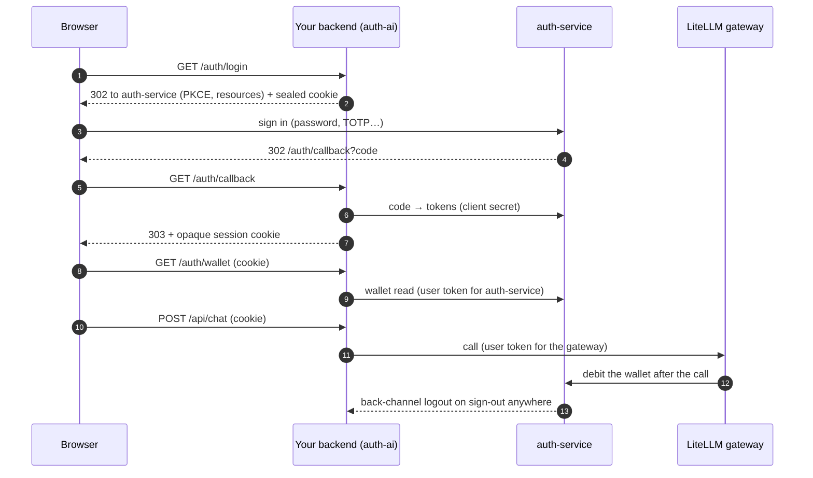

<p align="center">
  <picture>
    <source media="(prefers-color-scheme: dark)" srcset="docs-site/public/logo-dark.svg">
    
  </picture>
</p>

<h1 align="center">CIRCLE auth-ai for Rust</h1>

<p align="center">
  <em>The Rust SDK for CIRCLE auth-service — sign-in, entitlements, billing and LLM credit, in one crate.</em>
</p>

<p align="center">
  <a href="https://github.com/circle-rd/auth-ai-rs/actions/workflows/ci.yml"></a>
  <a href="https://crates.io/crates/auth-ai"></a>
  <a href="https://docs.rs/auth-ai"></a>
  <a href="LICENSE"></a>
  <a href="https://www.rust-lang.org"></a>
  <a href="https://github.com/rust-lang/rust-clippy"></a>
  <a href="https://github.com/circle-rd/auth-service"></a>
</p>

Let your application sign users in with a self-hosted
[CIRCLE auth-service](https://github.com/circle-rd/auth-service), read what they
are entitled to (roles, permissions, plan features), meter what they consume,
and call LLMs on their behalf through a [LiteLLM](https://docs.litellm.ai)
gateway that bills their credit wallet — without writing any OAuth, token
refresh, logout or billing plumbing yourself.

This is the Rust port of [`@circle-rd/auth-ai`](https://github.com/circle-rd/auth-ai-ts)
and [`auth-ai`](https://github.com/circle-rd/auth-ai-py): same behaviours, same
wire contract, same error codes. A Rust backend can serve the TypeScript browser
client and the React and Vue bindings unchanged, and sessions sealed by one
backend are readable by another.

API reference: **https://docs.rs/auth-ai**

```rust,no_run
use auth_ai::axum::{AuthError, AuthSession, auth_router};
use auth_ai::web::{AuthHandlers, MemorySessionStore, SessionStore};
use auth_ai::{AiClient, AuthClient, AuthClientConfig, GatewayModel, GrantManager, MemoryGrantStore};
use axum::extract::{FromRef, State};
use axum::routing::get;
use axum::{Json, Router};
use std::sync::Arc;

#[derive(Clone)]
struct AppState {
    handlers: AuthHandlers,
    ai: AiClient,
}

impl FromRef<AppState> for AuthHandlers {
    fn from_ref(state: &AppState) -> Self {
        state.handlers.clone()
    }
}

async fn models(
    State(state): State<AppState>,
    AuthSession(session): AuthSession,
) -> Result<Json<Vec<GatewayModel>>, AuthError> {
    let user = state.ai.for_user(&session.user_id)?;
    Ok(Json(user.gateway()?.list_models().await?))
}

#[tokio::main]
async fn main() -> Result<(), Box<dyn std::error::Error>> {
    let auth = AuthClient::new(
        AuthClientConfig::builder(
            "https://auth.example.com",
            "my-app",
            "https://app.example.com/auth/callback",
        )
        .client_secret(std::env::var("AUTH_CLIENT_SECRET")?)
        .gateway_url("https://llm.example.com")
        .build()?,
    )?;
    let grants = GrantManager::new(auth.clone(), MemoryGrantStore::new());
    let ai = AiClient::new(auth.clone(), grants.clone());
    let sessions: Arc<dyn SessionStore> = Arc::new(MemorySessionStore::new());
    let handlers = AuthHandlers::builder(auth, grants, sessions, std::env::var("COOKIE_SECRET")?)
        .ai(ai.clone())
        .build()?;

    // /auth/login, /callback, /me, /logout…
    let app = Router::new()
        .merge(auth_router::<AppState>(handlers.clone()))
        .route("/api/models", get(models))
        .with_state(AppState { handlers, ai });
    axum::serve(tokio::net::TcpListener::bind("0.0.0.0:8080").await?, app).await?;
    Ok(())
}
```

## Principles

- **Do not reinvent OAuth or JOSE.** The cryptography stays with the maintained
  [`aws-lc-rs`](https://crates.io/crates/aws-lc-rs) and HTTP with
  [`reqwest`](https://crates.io/crates/reqwest) (rustls). The JWS verification
  itself is a small in-crate layer over `aws-lc-rs`, because no maintained Rust
  JOSE crate verifies the fully specified `Ed25519` algorithm name yet (see
  [Signing algorithms](#production)). The declared direct runtime dependencies
  are licensed under MIT, Apache-2.0 or ISC.
- **Backend-for-frontend by default.** The browser holds one opaque session
  cookie. Access and refresh tokens never reach it.
- **Fail loud, leak nothing.** Invalid state is rejected, not repaired. Errors
  carry stable codes; HTTP responses expose the code and a generic message, and
  the detail stays in your logs. Credentials are `SecretString`s: they never
  print and are wiped on drop.
- **Strict at every boundary.** Every external payload (tokens, API answers,
  cookies, configuration) is parsed into a typed model before use. The crate
  forbids `unsafe`, denies Clippy warnings, and keeps `unwrap`, `expect`,
  `panic!` and unchecked indexing out of production code.
- **Async all the way.** Built on `tokio`; plug your own `Transport` for
  proxies, mTLS or tracing.
- **Centralized spending.** The SDK never debits a wallet itself: the gateway
  bills each call, so margin and pricing stay under the administrator's control.

## Features

**Sign-in and sessions**

- Authorization-code flow with PKCE, `state` and `nonce`, multi-audience
  tokens ([RFC 8707](https://www.rfc-editor.org/rfc/rfc8707)), TOTP handled by
  the provider.
- One serialized refresh-token chain per user, with per-audience access tokens
  minted on demand and never stored. A caller that gives up never aborts a
  rotation half-way.
- Sealed one-shot login cookie (a compact JWE, interoperable with the
  TypeScript and Python SDKs), hashed session ids, `__Host-` cookies,
  same-origin redirect targets, refused cross-site logout.
- Claims (roles, permissions, features, plan, organization) renewed from the
  provider on a schedule, with simultaneous requests sharing one renewal.
- **Back-channel logout**: signature, `typ`, audience, event, lifetime and
  replay checks, then the sessions and grant of the user end.

**Entitlements**

- Typed claims and helpers: `has_role`, `has_permission` (write implies read),
  `has_feature`, `get_feature`.
- Bearer-token verification for your own API, with RFC 9728
  protected-resource metadata and `WWW-Authenticate` challenges (MCP-friendly).

**LLM gateway and credit wallet**

- One switch in auth-service ("LiteLLM support") and one option here
  (`gateway_url`) turn on the gateway and wallet audiences.
- An origin-locked gateway client: the user's token is only ever sent to the
  gateway; model, agent and MCP server listing; gateway errors mapped (`402` →
  `GW_001`, `429` with `Retry-After`, …); fresh tokens for OpenAI-compatible
  clients.
- Wallet reads: balance, spend statistics, per-session usage, transactions,
  top-up link. Amounts are exact `i128` micro-euros.

**Billing and consumption**

- Machine client (`client_credentials`, cached and single-flighted): a user's
  subscription, metered usage and invoices; usage reporting with idempotency
  keys for features billed per call.

**Resource sharing**

- Machine client for adapter services and scheme owners: ask auth-service
  whether a user may use a shared resource (`authorize`, fail closed), list what
  they can reach, and report the validation or loss of ownership of a resource
  (`validate`, `invalidate`); report what a provider billed for a shared resource
  (`record_usage`, idempotent).

**Delivery**

- Framework-agnostic `WebRequest` → `WebResponse` handlers (mount them
  anywhere) and an optional axum adapter (`axum` feature).
- Rust 1.89+, edition 2024, MIT licensed.

## Install

```sh
cargo add auth-ai --features axum   # or plain `cargo add auth-ai`
```

Register your application in auth-service first: a confidential application with
the **LiteLLM support** switch on (if you call the gateway), the redirect URI
`https://<host>/auth/callback` and the back-channel logout URI
`https://<host>/auth/backchannel-logout`.

## Quick start

The stores of the example above live in memory: demo only, see
[Production](#production).

Calling the gateway from your backend. Pass `access_token()` to an
OpenAI-compatible client (fetch it again for every request: it lives one hour),
or let the SDK send the request:

```rust,no_run
use auth_ai::{AiClient, AuthAiError};
use serde_json::{Value, json};

async fn ask(ai: &AiClient, user_id: &str) -> Result<Value, AuthAiError> {
    let user = ai.for_user(user_id)?;
    user.gateway()?
        .post_json(
            "/v1/chat/completions",
            &json!({ "model": "my-model", "messages": [{ "role": "user", "content": "Hello" }] }),
        )
        .await
}
```

Reporting usage for a feature billed per call, from your backend:

```rust,no_run
use auth_ai::AuthClient;
use auth_ai::server::MachineApi;

async fn report(auth: &AuthClient, user_id: &str) -> Result<(), auth_ai::AuthAiError> {
    let machine = MachineApi::new(auth)?;
    machine.consumption.report(user_id, "audits", 1_i64, Some("audit-42")).await?;
    Ok(())
}
```

## Modules

| Import           | What it gives you                                                                        |
| ---------------- | ---------------------------------------------------------------------------------------- |
| `auth_ai`        | OIDC client, grants, claims helpers, wallet and gateway clients, error registry          |
| `auth_ai::server`| Bearer verification, back-channel logout, protected-resource metadata, machine API       |
| `auth_ai::web`   | Sign-in handlers (`WebRequest` → `WebResponse`), session store contract                  |
| `auth_ai::axum`  | `auth_router`, `AuthSession` and `OptionalAuthSession` for axum 0.8 (`axum` feature)     |

## Architecture



```text
auth-ai-rs/
├── 📁 src/
│   ├── client.rs          AuthClient — discovery, PKCE login, refresh, logout, revoke, introspect
│   ├── config.rs          Validated configuration (gateway_url adds the gateway audiences)
│   ├── grants.rs          GrantManager — serialized refresh rotation, per-audience tokens
│   ├── claims.rs          Claim models and entitlement helpers
│   ├── wallet.rs          WalletClient and wallet models (i128 micro-euros)
│   ├── gateway.rs         GatewayClient — origin-locked requests, listings, MCP URLs
│   ├── ai.rs              AiClient::for_user(grant_id)
│   ├── error.rs           AuthAiError + ErrorCode registry (OIDC_*, TOK_*, GW_*, SES_*…)
│   ├── transport.rs       The HTTP seam: Transport and the default reqwest client
│   ├── 📁 server/         Bearer verification, back-channel logout, machine API
│   ├── 📁 web/            Sign-in handlers, sealed cookies, session store contract
│   └── axum.rs            axum adapter
└── 📁 tests/              Integration suite on a scripted identity provider (no network)
```

## Production

The SDK is storage-agnostic on purpose. Before going live:

- **Persist sessions and grants.** Implement `SessionStore` and `GrantStore` on
  your database. The in-memory stores sign everyone out on restart and cannot
  be shared by replicas.
- **Several replicas?** Provide a distributed `GrantLock` (a refresh token
  rotates on every use; a replayed one revokes the whole family) and a shared
  `ReplayStore` for back-channel logout tokens.
- **Secrets from the environment only:** the client secret and a 32+ character
  cookie secret. Neither is ever logged or returned.
- **Registered URIs must match:** `redirect_uri` is `<origin><base_path>/callback`
  and the back-channel URI is `<origin><base_path>/backchannel-logout`, reachable
  over HTTPS by auth-service.
- **Log with `on_error`, answer with `to_public_json()`.** Never forward
  `error.message()` or `error.details()` to a browser.
- **Signing algorithms.** auth-service signs with ES256 (or RS256). The SDK
  verifies ES256/384/512, RS256/384/512, PS256/384/512 and the fully specified
  `Ed25519`, pinned to the single algorithm the provider advertises. `EdDSA`
  (deprecated by RFC 9864), HMAC and `none` are never accepted. `Ed448` is not
  supported (no maintained pure-Rust implementation): a provider that only
  advertises it fails discovery with `OIDC_001`.
- **Keep your web stack current:** keep `axum` and `tokio` on a release that
  carries the latest security fixes, and run `cargo audit`.

## Documentation

The full documentation is published at
[docs.circle-cyber.com/auth-ai/rust](https://docs.circle-cyber.com/auth-ai/rust/):
concepts, the axum guide and the framework-agnostic handlers, the configuration
and API reference, the error-code registry and a production checklist. The API
reference is also on [docs.rs/auth-ai](https://docs.rs/auth-ai). The same
documentation exists for the
[TypeScript](https://docs.circle-cyber.com/auth-ai/typescript/) and
[Python](https://docs.circle-cyber.com/auth-ai/python/) SDKs.

**For AI agents** — the documentation is exposed through a built-in MCP server
(HTTP), so agents can query it directly:

| Environment | MCP endpoint                                                         |
| ----------- | -------------------------------------------------------------------- |
| Production  | `https://docs.circle-cyber.com/auth-ai/rust/mcp`                     |
| Local dev   | `http://localhost:3000/mcp` (run `npm run dev` in `docs-site/`)      |

**Contributing** — the development rules in [AGENTS.md](AGENTS.md) (naming,
typing strictness, error handling, testing, security) and the process in
[CONTRIBUTING.md](CONTRIBUTING.md) are mandatory for any contribution.
Security reports: see [SECURITY.md](SECURITY.md). Releases are tracked in
[CHANGELOG.md](CHANGELOG.md).

## Roadmap

- **More adapters** (actix-web, Rocket) on top of the framework-agnostic
  handlers, as needs appear.
- **Ed448 verification**, once a maintained Rust implementation exists.

## Credits & license

Built and maintained by [CIRCLE](https://circle-cyber.com). Stands on the
shoulders of [reqwest](https://crates.io/crates/reqwest),
[aws-lc-rs](https://crates.io/crates/aws-lc-rs), [serde](https://serde.rs),
[tokio](https://tokio.rs) and [axum](https://crates.io/crates/axum).

Licensed under the **MIT License** — see [LICENSE](LICENSE).
